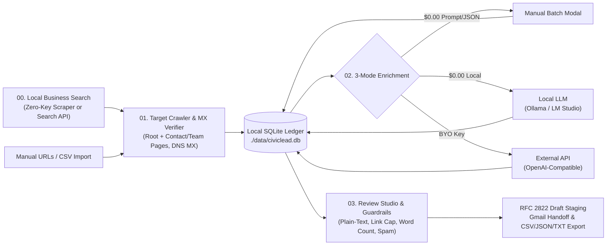

# CivicLead Engine

[](LICENSE)
[](https://nodejs.org/)
[](tsconfig.json)
[](https://react.dev/)
[](server/db.ts)

**Local-first, open-source B2B target crawler, three-mode workflow enrichment engine, and human-in-the-loop plain-text Gmail draft staging studio.**

CivicLead Engine discovers local or B2B company domains, crawls public contact and leadership pages with real DNS MX verification, generates grounded one-to-one outreach copy across zero-cost or OpenAI-compatible AI engines, enforces strict plain-text deliverability guardrails, and stages RFC 2822 `text/plain` drafts for human review—all stored locally in SQLite on your own machine.

---

## Core Philosophy

- **Local-First SQLite Ledger**: All leads, product profiles, engine settings, and staged RFC 2822 draft logs persist locally in `./data/civiclead.db` using Node's built-in `node:sqlite`. Zero cloud lock-in, zero telemetry.
- **Zero Fabricated Emails**: CivicLead never guesses `info@` or role-based fallback addresses. Every candidate email is extracted from live crawled pages (`mailto:`, JSON-LD, body/footer text) or entered manually by the operator, paired with real DNS MX verification.
- **100% Plain-Text `text/plain` Outreach**: Built to land in primary inboxes—zero HTML wrappers, zero tracking pixels, zero markdown formatting, capped bare URLs, and automated spam-trigger detection.
- **Provider-Agnostic 3-Mode AI Engine**:
  - **A. Manual Batch (`$0.00`)**: Export structured prompts and import JSON responses from any external chat session.
  - **B. Local LLM (`$0.00`)**: Connect to local Ollama, LM Studio, or any local OpenAI-compatible `/v1` inference server.
  - **C. External API (BYO Key)**: Connect to Google Gemini (OpenAI-compatible), OpenRouter, OpenAI, Groq, or any custom `/chat/completions` endpoint.
- **Human-in-the-Loop Review Studio**: Split-screen inspection of crawled company context, real-time deliverability checks, manual recipient overrides, Gmail compose/Mail App handoff, and RFC 2822 staging.

---

## Architecture & Pipeline



---

## Feature Deep-Dive

### 00. Local Business Discovery
- **Zero-Key Built-in Scraper (`$0.00`)**: Queries public listings (YellowPages & DuckDuckGo HTML), automatically filters out social networks, aggregators, and directory domains (`yelp.com`, `linkedin.com`, `angi.com`, `.gov`, `.edu`, etc.), and includes a copyable Zero-API Search Prompt fallback if search engines rate-limit requests.
- **Optional Search APIs**: Plug in **Serper.dev**, **Brave Search**, **Tavily**, or a **Custom Search Endpoint** (supports `{query}` GET templates or JSON POST).
- **Manual Ingestion**: Add a single domain, paste up to 25 URLs/domains in bulk, or upload `.csv` / `.txt` files.

### 01. Target Crawler & DNS MX Verification
- Crawls each target domain's root page (with `https`/`http` and `www.` fallback) plus up to 5 highest-scoring internal pages (`/contact`, `/about`, `/team`, `/leadership`, `/estimating`, etc.).
- Extracts structured **JSON-LD** (`Organization`, `LocalBusiness`, `Person`, `contactPoint`), `mailto:` / `tel:` links, obfuscated addresses (`[at]` / `[dot]` and HTML entities), and leadership names.
- Performs live **DNS MX** lookups (`dns.resolveMx`) and ranks candidates into `named`, `desk` (`estimating`, `bids`, `projects`), and `generic` priorities.
- Guarantees row persistence even when a website blocks automated HTTP fetches (`HTTP Blocked (MX Checked)`).
- Detects **Duplicate Inbox Aliases** when multiple discovered domains route to the same email address so you never double-email an inbox.

### 02. Three-Mode AI Enrichment Engine
- Dynamic model discovery (`POST /api/ai/models`) and live connection latency testing (`POST /api/ai/test`).
- Configurable **Product Profile** (`ProductProfileView` + inline editor) specifying Business Name, Website URL, Sender Name/Email, Value Proposition, Target Industries, Offer/Trial Terms, Promo Code + Exact Promo Meaning, Proof Snippet, CTA, and Max Links.
- Strict zero-hallucination prompting contract (`src/shared/guardrails.ts`) with non-target industry detection (`isTargetFit` / `fitWarning`).

### 03. Deliverability Guardrails & Review Queue
Every email draft is evaluated in real time by `evaluateDeliverability` before staging or handoff:
1. **Plain-text only**: 0 HTML tags and 0 Markdown syntax (`**bold**`, `[links](url)`, `# headings`).
2. **Link cap**: Bare URLs capped at `profile.maxLinks` (default `1`).
3. **Concise conversational length**: 40–175 words.
4. **Zero spam/ad triggers**: Flags hype phrases (`free trial!`, `act now`, `guaranteed`, `streamline`, `leverage`, `game-changer`, multiple exclamation marks, `% off!`).

Staged drafts generate a clean RFC 2822 `text/plain; charset="UTF-8"` MIME message and base64url Gmail payload (`server/gmailDraft.ts`), alongside **Open in Gmail**, **Mail App (`mailto:`)**, **Copy Draft**, and **CSV / JSON / Plain Text** batch exports.

---

## Security & Privacy Architecture

CivicLead Engine is hardened for safe local-first operation:

- **Loopback Binding by Default**: Binds to `127.0.0.1` (`HOST` configurable via environment variable) rather than exposing the unauthenticated control plane on `0.0.0.0`.
- **SSRF & DNS Rebinding Protection (`server/security.ts`)**:
  - Target crawling, DNS MX checks, and custom search endpoints validate hostnames via `isValidPublicDomain` and resolve DNS via `assertSafePublicUrl` before issuing requests, blocking loopback (`127.0.0.0/8`, `::1`), RFC 1918 private networks (`10.0.0.0/8`, `172.16.0.0/12`, `192.168.0.0/16`), CGNAT (`100.64.0.0/10`), link-local / cloud metadata (`169.254.169.254`, `fe80::/10`, `metadata.google.internal`), and IPv4-mapped IPv6 addresses.
  - `safeFetchHtml` manually follows up to 4 redirects, re-validating every redirect hop with `assertSafePublicUrl`, and enforces a strict 2 MB response byte limit.
  - AI Base URL validation (`assertSafeAiBaseUrl`) allows local inference servers (`localhost`) while blocking cloud metadata IPs, non-HTTP(S) schemes, and credentialed URLs.
- **API Key Masking & Storage Hygiene**:
  - `GET /api/settings` and `PUT /api/settings` mask stored API keys (`••••••••xxxx`). Masked tokens sent back from the UI never overwrite real persisted keys.
  - Frontend `localStorage` caches only placeholder masks (`••••••••`), never plaintext API keys.
  - SQLite directory (`./data`), database file, and `user-settings.json` are created with restricted permissions (`0700` / `0600` on POSIX systems) and ignored in `.gitignore`.
- **CSRF Origin Guard & Security Headers**:
  - Mutating `/api/*` requests (`POST`, `PUT`, `PATCH`, `DELETE`) verify `Origin` / `Referer` hostnames against allowed local/configured hosts.
  - Sets `X-Content-Type-Options: nosniff`, `X-Frame-Options: DENY`, `Referrer-Policy`, `Permissions-Policy`, `Cross-Origin-Opener-Policy`, `Cross-Origin-Resource-Policy`, and a production `Content-Security-Policy`.
  - Disables `X-Powered-By`, enforces a `1mb` JSON body limit, and rate-limits heavy crawl/discovery/AI routes (`30 req / min`).
- **CSV Formula Injection Neutralization & Input Validation**:
  - CSV exports (`server/exporter.ts`) prefix cells beginning with `=`, `+`, `-`, `@`, `\t`, or `\r` with `'` to neutralize spreadsheet formula injection (CWE-1236).
  - `PATCH /api/leads/:id` strictly whitelists mutable fields and validates status values; `POST /api/enrich/import` caps batch size at 100 items and validates public domains; frontend link rendering enforces `http://` / `https://` protocols.

---

## Quick Start

### Prerequisites
- **Node.js `>= 22.5.0`** (required for built-in `node:sqlite`)
- **npm** (or Bun)

### Installation & Development

```bash
# 1. Clone the repository
git clone https://github.com/danielharderpi-png/civiclead.git
cd civiclead

# 2. Install dependencies
npm install

# 3. (Optional) Copy environment template
cp .env.example .env

# 4. Start the development server (Express API + Vite middleware)
npm run dev
```

Open `http://127.0.0.1:3000` (or `http://localhost:3000`) in your browser.

### Production Build & Start

```bash
# Typecheck TypeScript
npm run lint

# Build the React frontend into dist/
npm run build

# Start in production mode (serves built dist/ assets + CSP)
NODE_ENV=production npm start
```

### Build Standalone Windows Executable (.exe)

Package CivicLead Engine into a single self-contained, zero-dependency portable `CivicLead.exe` (using Node.js Single Executable Applications with embedded frontend assets and built-in `node:sqlite`):

```bash
npm run build:exe
```

Double-clicking `CivicLead.exe` (or running it from a terminal) starts the local server on `http://127.0.0.1:3000`, automatically opens the UI in your default browser, and stores `./data/civiclead.db` and `user-settings.json` portably alongside `CivicLead.exe`. Pass `--no-open` (or set `CIVICLEAD_NO_OPEN=1`) to skip launching the browser automatically.

---

## Environment Variables

Running CivicLead locally does **not** require a `.env` file—all AI and Search providers can be configured in the UI. Optional `.env` settings:

| Variable | Default | Description |
| --- | --- | --- |
| `PORT` | `3000` | HTTP port for the Express server |
| `HOST` | `127.0.0.1` | Bind address (`127.0.0.1` recommended for local-first security) |
| `APP_URL` | `http://localhost:3000` | Allowed origin hostname for the CSRF guard when reverse-proxied |
| `GEMINI_API_KEY` | `""` | Optional fallback API key when using Gemini OpenAI-compatible mode |
| `OPENAI_API_KEY` | `""` | Optional fallback API key when using OpenAI mode |
| `SERPER_API_KEY` | `""` | Optional fallback API key for Serper.dev search discovery |
| `BRAVE_API_KEY` | `""` | Optional fallback API key for Brave Search discovery |
| `TAVILY_API_KEY` | `""` | Optional fallback API key for Tavily Search discovery |

---

## REST API Reference

| Method & Endpoint | Description |
| --- | --- |
| `GET /api/health` | Health check and relative SQLite ledger path |
| `GET /api/settings` | Fetch persisted engine and search settings (API keys masked) |
| `PUT /api/settings` | Save engine and search settings (preserves masked keys) |
| `GET /api/profile` | Fetch active `ProductProfile` |
| `PUT /api/profile` | Update `ProductProfile` (sanitizes external `websiteUrl`) |
| `POST /api/profile/reset-blank` | Reset `ProductProfile` to blank defaults |
| `GET /api/leads` | List all leads and staged draft logs from SQLite |
| `POST /api/discover` | Discover local business domains via built-in scraper or configured Search API |
| `POST /api/crawl` | Crawl up to 25 domains/URLs with SSRF checks and DNS MX verification |
| `POST /api/ai/models` | Query `/models` or `/api/tags` on an OpenAI-compatible provider |
| `POST /api/ai/test` | Send a lightweight chat completion ping to verify model connectivity |
| `POST /api/enrich` | Enrich selected crawled leads via Local LLM or External API |
| `POST /api/enrich/import` | Import up to 100 enriched lead JSON objects from Manual Batch mode |
| `PATCH /api/leads/:id` | Update whitelisted lead fields or verify/assign a manual email |
| `DELETE /api/leads/batch` | Delete selected lead IDs or clear all leads (`{ all: true }`) |
| `DELETE /api/leads/:id` | Delete a single lead by ID |
| `POST /api/gmail/draft` | Validate deliverability guardrails and stage an RFC 2822 `text/plain` draft |
| `GET /api/export/batch` | Export leads as CSV, JSON, and Plain Text (`?status=enriched\|approved\|all`) |

---

## Repository Structure

```text
civiclead/
├── server.ts                       # Express API server, middleware & Vite/static serving
├── server/
│   ├── security.ts                 # SSRF/DNS validation, safe fetch, masking, CSRF, headers, rate limiting
│   ├── crawler.ts                  # HTML/JSON-LD scraper, email extraction & DNS MX verification
│   ├── discoverer.ts               # Zero-key YellowPages/DDG + Serper/Brave/Tavily/Custom search
│   ├── enricher.ts                 # OpenAI-compatible model discovery, connection test & enrichment
│   ├── exporter.ts                 # CSV (formula-safe) & plain-text batch exporters
│   ├── gmailDraft.ts               # RFC 2822 text/plain MIME & base64url payload builder
│   ├── db.ts                       # node:sqlite schema & persistence helpers
│   └── settings.ts                 # Settings persistence with masked-key preservation
├── src/
│   ├── App.tsx                     # Top-level workspace shell & browser storage sanitization
│   ├── shared/
│   │   ├── guardrails.ts           # Prompt contracts, JSON parser, deliverability & fit checks
│   │   └── types.ts                # Shared TypeScript interfaces, presets & normalizers
│   └── components/
│       ├── DiscoveryView.tsx       # Business search, manual ingestion, target ledger & enrichment
│       ├── ReviewQueueView.tsx     # Split-screen review studio, deliverability bar & handoff
│       ├── ProductProfileView.tsx  # Product & offer profile editor with JSON import/export
│       ├── EngineSetupModal.tsx    # Provider-agnostic AI engine configuration modal
│       ├── ManualBatchModal.tsx    # $0.00 prompt export & JSON import modal
│       ├── DraftConfirmModal.tsx   # Pre-staging RFC 2822 confirmation modal
│       └── ExportBatchModal.tsx    # CSV / JSON / TXT export preview & download modal
├── SECURITY.md                     # Security policy & vulnerability reporting
├── CONTRIBUTING.md                 # Contribution guidelines
├── CODE_OF_CONDUCT.md              # Contributor Covenant v2.1
└── LICENSE                         # MIT License
```

---

## License

Released under the [MIT License](LICENSE). Copyright (c) 2026 Daniel L. Harder.
